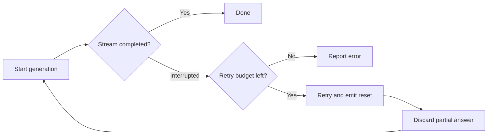

> Detailed documentation preserved from the initial development phase. Run commands from the repository root.

# Complete usage guide for reliable-requests

[ ](https://github.com/Stairrax/reliable-requests/actions/workflows/test.yml)

[](../LICENSE)

**Recover from interrupted local AI streams without mixing two different answers.**

A small, dependency-free JavaScript toolkit for Node.js 18+ and modern browsers. Built for text generation with Ollama, LM Studio, and llama.cpp. Works with any compatible installed model, including Qwen.

## Try the visual demo

```bash
npm run demo
```

Open **http://127.0.0.1:4173**. Choose **Simulate interruption** (default), click **Start stream**, and watch the partial answer get discarded before a fresh one appears. **No neural model, GPU, or internet required** for this simulation.

Switch to **Live local model** after starting Ollama, LM Studio, or llama.cpp. The demo runs in your browser and connects to your own local model directly, so the model server must allow the page origin through CORS. The static demo server neither stores messages nor proxies requests. The live demo accepts loopback endpoints only.

## How recovery works



**Important:** restarting is not continuing the same generation. The model might produce different words. The library emits `reset` so callers **replace**, not append to, the interrupted response. Only text-only requests are supported; tool calls are not automatically executed.

## Four ways to try it

| Goal | Command |
| --- | --- |
| Run unit + real HTTP fault tests | `npm test` |
| Open the interactive browser demo | `npm run demo` |
| Test an installed Ollama model | `MODEL_NAME=qwen2.5:0.5b npm run test:model` |
| Test a forced real Ollama disconnect | `MODEL_NAME=qwen2.5:0.5b npm run test:ollama:recovery` |

The model name shown is an example: install a model with Ollama first, or use a model already present. For OpenAI-compatible local servers, see the [real-model instructions](#test-on-a-real-model-optional). On Windows PowerShell, use the environment-variable examples in that section.

## Local model streams

`streamLocalChat` is the distinctive part of this project: it can restart a **text-only** local-model stream after a partial answer. Before the next attempt it emits `reset`, so the caller replaces the old answer instead of appending a second generation to it. It works with any model name served by Ollama's native chat API or an OpenAI-compatible chat-completions endpoint (for example, LM Studio or llama.cpp). The model does not need to be Qwen.

```js
import { streamLocalChat } from './src/local-chat.js';

let shown = '';
await streamLocalChat({
  endpoint: 'http://localhost:11434',
  protocol: 'ollama',
  model: 'qwen2.5:7b',
  messages: [{ role: 'user', content: 'Explain recursion simply.' }],
  timeoutMs: 60_000,
  onEvent(event) {
    if (event.type === 'reset') shown = '';
    if (event.type === 'delta') shown += event.text;
    if (event.type === 'retry') console.log('Restarting generation:', event.error.message);
    if (event.type === 'done') console.log(shown);
  },
});
```

For an OpenAI-compatible local server, set `protocol: 'openai'` (the default) and `endpoint: 'http://localhost:1234/v1'` for LM Studio or your llama.cpp server URL. The function adds `/v1/chat/completions` itself, preserving any proxy path prefix; if the endpoint already ends in `/v1`, it adds only `/chat/completions`. `fetchImpl` and `headers` are optional. `signal` cancels the operation.

The parser limits each NDJSON or SSE protocol line to **262,144 JavaScript characters** by default. This bounds the pending line buffer without limiting the total length of a completed answer. Override with `maxLineChars` (between 1 and 4,194,304), e.g. `maxLineChars: 524288` for an unusually large event. A line exceeding the limit fails with `StreamLineTooLongError` and `code === 'STREAM_LINE_TOO_LONG'`; this is **not automatically retried**. These limits describe parser memory, not model token limits.

The callback receives `attempt`, `delta`, `retry`, `reset`, and `done` events. Its work should be synchronous. A retry begins only for a transient HTTP status (429, 500, 502, 503, 504), a network error, or a stream ending before its completion marker. Invalid requests and malformed protocol events fail without retry. The same total deadline covers the stream and retry waits. The function returns `{ attempts }` on success. When the server reports a completion reason, both the result and the `done` event also include `finishReason`: for example, `length` signals an output truncated by a model limit. Servers may omit the reason; its absence is not proof of a complete answer. Tool calls fail with `UnsupportedModelOutputError` rather than being silently discarded. Exceptions from `onEvent` propagate without retrying the model.

A restart runs the model again and may produce different text. Local inference uses extra compute; remote services may charge again. For that reason automatic retries are enabled by default only for loopback addresses. To permit them for a remote endpoint, explicitly set `allowRemoteRetries: true`. This is **not** an exactly-once guarantee. This first version accepts text messages only and does not execute model tool calls. Browser apps also need their local server to allow the browser origin through CORS.

## General fetch wrapper

It gives one deadline to the whole operation: attempts, pauses before retries, and response reading **when you provide a `consume` function**. It uses `AbortSignal` for cancellation and retries only `GET` and `HEAD` by default.

This is an early, unpublished project. Install it from a checkout while the API and license are being decided.

## Try it

```js
import { reliableRequest } from './src/index.js';

const user = await reliableRequest('https://example.com/api/user', {
  timeoutMs: 8_000,
  retries: 2,
  consume: response => response.json(),
});
console.log(user);
```

Without `consume`, the function returns a normal `Response` as soon as headers arrive. The deadline then ends, so later reads of `response.body` are **not** covered. Use `consume` whenever the full body or a stream must finish within the deadline.

## Optional stream metrics

Track the connection without changing request or retry behavior. No analytics are sent anywhere; the counters stay in your application.

```js
import { createStreamMetrics } from './src/metrics.js';
import { streamLocalChat } from './src/local-chat.js';

const metrics = createStreamMetrics();
try {
  await streamLocalChat({
    endpoint: 'http://127.0.0.1:11434',
    protocol: 'ollama',
    model: 'your-installed-model',
    messages: [{ role: 'user', content: 'Hello!' }],
    onEvent(event) {
      metrics.record(event);
      // Render reset/delta events in your UI here.
    },
  });
} finally {
  metrics.finish();
  console.log(metrics.snapshot());
}
```

Metrics include attempts, retries, resets, text delta events, visible characters after the last reset, total received characters, first-text latency, and elapsed time. **Characters are not tokens**, and these measurements are not benchmarks of model inference speed. Results are read-only snapshots.

## Cancellation

```js
const controller = new AbortController();
const pending = reliableRequest('https://example.com/api/user', {
  signal: controller.signal,
  consume: response => response.text(),
});
controller.abort();
await pending; // rejects with AbortError
```

An already aborted signal sends no request. Cancellation also interrupts retry delays. A timeout rejects with `RequestTimeoutError` and `code === 'REQUEST_TIMEOUT'`. The wrapper aborts its own fetch signal and rejects on time even if a custom fetch implementation ignores abort.

## Streaming

Keep the reader inside `consume` and release it when finished. The wrapper's signal tells you when to stop. This example collects chunks; a UI can process each chunk as it arrives.

```js
const chunks = await reliableRequest('https://example.com/events', {
  timeoutMs: 30_000,
  consume: async (response, signal) => {
    const reader = response.body.getReader();
    const chunks = [];
    const onAbort = () => { reader.cancel().catch(() => {}); };
    signal.addEventListener('abort', onAbort, { once: true });
    try {
      while (true) {
        const { value, done } = await reader.read();
        if (done) return chunks;
        chunks.push(new TextDecoder().decode(value, { stream: true }));
      }
    } finally {
      signal.removeEventListener('abort', onAbort);
      reader.releaseLock();
    }
  },
});
```

The deadline includes the entire stream. If it expires after some chunks were delivered, the promise rejects; those chunks may already have reached your UI. Do not silently retry a partially delivered stream. For SSE, parse events in your consumer and treat a protocol marker such as `[DONE]` according to the server's rules.

## Retry policy and errors

`retries` means additional attempts (default 2); `timeoutMs` defaults to 30,000 ms. Only `GET` and `HEAD` retry. A network `TypeError` or HTTP 429, 500, 502, 503, or 504 may retry. HTTP 4xx errors such as 401 and 404 fail immediately. Delays use exponential backoff; `Retry-After` in seconds or HTTP date is honored up to 30 seconds. Every delay consumes the same total time budget.

`POST`, `PUT`, `PATCH`, and `DELETE` are never retried. Repeating one could create a duplicate operation or charge twice. If your API has an idempotency key contract, put a separate, explicit retry policy around that operation.

An unsuccessful final response throws `HttpError` with `status`, `response`, and `attempts`. The response body remains available for diagnosis. Transport errors retain their original error. Errors thrown by `consume` propagate and are not retried, because the body or a stream may already have been partly read.

Pass ordinary `fetch` options such as `headers`, `credentials`, and `method` alongside the options above. The first argument must be a URL string or `URL`; `Request` objects are not supported because their bodies may be one-shot. `fetchImpl` is available for tests or a compatible custom implementation.

## Run tests

```sh
npm test
```

The automated tests use Node's built-in test runner and require no dependency installation or AI model.

## Tests over real HTTP

Run all automated tests with:

    npm test

The integration tests start an actual HTTP server on your computer (not a fake fetch). They test both Ollama NDJSON and OpenAI-compatible SSE, break connections after the first words, stall streams, send transient server errors, and verify cancellation, deadline enforcement, and safe retry boundaries. You do not need to install a model, GPU drivers, or extra dependencies.

## Test against an installed local model

First start your existing Ollama, LM Studio, or llama.cpp server. Then use the optional smoke test. It sends a short text prompt, prints the streamed answer, and reports whether the protocol completed.

For Ollama, first run ollama list to find your installed model. For example:

    MODEL_PROTOCOL=ollama MODEL_NAME=qwen2.5:7b npm run test:model

The model name is an example; use one you actually have installed. The default Ollama endpoint is http://127.0.0.1:11434. If it is not running, start it normally (for example with ollama serve).

For an OpenAI-compatible endpoint in LM Studio or llama.cpp:

    MODEL_PROTOCOL=openai MODEL_ENDPOINT=http://127.0.0.1:1234/v1 MODEL_NAME=your-installed-model npm run test:model

Replace the model and address with your server settings. For slow local models you can specify a larger deadline in milliseconds, for example MODEL_TIMEOUT_MS=300000.

On Windows PowerShell, an Ollama example is:

    $env:MODEL_PROTOCOL = 'ollama'
    $env:MODEL_NAME = 'qwen2.5:7b'
    npm run test:model

The smoke test does not retry a real model call automatically: it only checks that one generation succeeds. To test interrupted streams and automatic recovery without breaking your own model server, run npm test. Those tests simulate failures predictably and confirm that reset replaces the partial output. A restarted generation is not a continuation of the old text.

## Optional long-stream Ollama stress check

After the normal live-model and recovery checks pass, you can sample repeated, longer responses with a real local Ollama model. **Git Bash**:

```bash
MODEL_NAME=qwen2.5:0.5b npm run test:ollama:stress
```

The test runs two regular generations by default, counts text chunks and characters without retaining the answer, and prints a few JavaScript heap snapshots. It does **not** deliberately interrupt the model. A 240-second total deadline is applied **per generation**, and `Ctrl+C` stops the script.

Set `STRESS_ROUNDS=1` for one run, or `MODEL_TIMEOUT_MS=300000` for a slower model. This uses only your local Ollama instance at `127.0.0.1`. CPU/GPU use will increase during generation. The sampled JavaScript heap **does not measure Ollama's own memory**, and passing the test does not prove that there are no memory leaks. If your model generates less than 500 characters, the script warns that the run was too short to be a strong long-answer stress sample.

## One-shot real Ollama connection-drop test

After the normal live-model test succeeds, you can check **recovery from an actual broken TCP stream** while Ollama stays running. This is an optional manual test and is not run automatically in CI because it requires a real installed model.

In **Git Bash** on Windows (or a macOS/Linux shell):

```bash
MODEL_NAME=qwen2.5:0.5b npm run test:ollama:recovery
```

Choose a model from `ollama list`. The default is `qwen2.5:0.5b`. For a different local Ollama port, set `OLLAMA_ENDPOINT=http://127.0.0.1:YOUR_PORT`. To allow a slow model more time, set `MODEL_TIMEOUT_MS=300000`.

In **Windows PowerShell**:

```powershell
$env:MODEL_NAME = 'qwen2.5:0.5b'
npm run test:ollama:recovery
```

The script checks that the model is installed, then starts a **temporary, random-port proxy bound only to 127.0.0.1**. It allows only two authenticated, text-only Ollama chat requests. On the first, it forwards the first real generated text event and deliberately drops the TCP connection. `streamLocalChat` should retry, emit `reset` to discard the partial answer, and complete a second fresh generation. The proxy does not stop Ollama, change your network settings, or send prompts to an outside server. It closes automatically at the end.

Expected success:

```text
Generation attempt 1
First connection interrupted: retrying safely
RESET: discarded partial text before the new answer
Generation attempt 2
Second generation completed

PASS: 2 attempts, 1 real connection cut, 1 retry, 1 reset.
```

**Limits:** this generates twice, using extra local compute. It does **not** resume the interrupted generation or guarantee identical text. Do not use the fault proxy with remote or billable inference endpoints. The automatic CI test uses a fake local Ollama upstream with real TCP sockets, while this manual command checks against your actual installed model.

## Why another wrapper?

[Ky](https://github.com/sindresorhus/ky) is a more complete fetch client and already has a `totalTimeout` option. [p-retry](https://github.com/sindresorhus/p-retry) retries arbitrary async work with a time budget and cancellation. [Got](https://github.com/sindresorhus/got) is a capable Node.js HTTP client. Use one of them when you need its broader features. This project focuses on local text-model streams that can restart after partial output with an explicit reset event. The general fetch wrapper remains available for ordinary HTTP calls.

The design was informed by a timeout fix in [helper-with-conspects](https://github.com/Stairrax/helper-with-conspects). This implementation is written independently; no source code was copied from that GPL-3.0-only project.

## Project status and contributing

This is a **draft API**, not a published package. The code is in the [draft PR](https://github.com/Stairrax/reliable-requests/pull/1). No release has been published and `package.json` is intentionally `private: true`.

- [CONTRIBUTING.md](../CONTRIBUTING.md) — how to run tests and propose changes
- [ROADMAP.md](../ROADMAP.md) — steps before the first release
- [GitHub Issues](https://github.com/Stairrax/reliable-requests/issues) — bug reports and features; remove access tokens and private prompts
- [SECURITY.md](../SECURITY.md) — security disclosure guidance

Node 18 and 22 are tested in CI. Real installed models and different browsers still need hands-on verification; passing automation does not prove universal compatibility.

## License

Copyright (C) 2026 Stairrax.

This project uses the GNU General Public License version 3 only (SPDX: GPL-3.0-only). See the complete terms in [LICENSE](LICENSE).

You may use, modify, and redistribute the code under GPL-3.0-only without asking the author individually, provided that you comply with the license. For different licensing terms, including commercial agreements, please [contact the maintainer via GitHub Issues](https://github.com/Stairrax/reliable-requests/issues) and describe your intended use. Other terms require a separate written agreement; reaching out does not by itself grant permission.

The code was independently written: no implementation was copied from helper-with-conspects. This is an unpublished draft; the package is still marked private.
